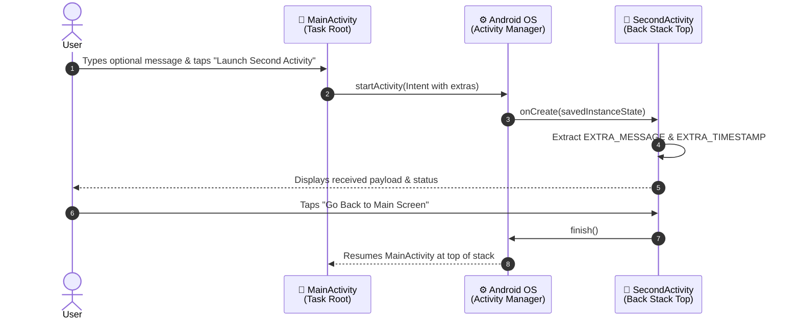

<div align="center">

# 📱 Android Activity Navigation

**A modern Android application demonstrating multi-activity lifecycle management, explicit Intent navigation with data transfer, and interactive spring physics animations built with Jetpack Compose.**

[](https://kotlinlang.org)
[](https://developer.android.com/jetpack/compose)
[](https://developer.android.com/studio)
[-34D399?style=for-the-badge&logo=android&logoColor=white)](https://www.android.com)

</div>

---

## 📖 Overview

This repository contains the completed project for the **Mobile Application Development** module assignment. The objective of this project is to explore and implement core Android fundamentals:

1. **Multi-Activity Lifecycle Management**: Defining, launching, and finishing independent activities.
2. **Explicit Intent Navigation**: Navigating between screens using explicit Android `Intent` declarations.
3. **Intent Extras & Data Passing**: Encapsulating and transmitting dynamic payloads across activity boundaries.
4. **Activity Back Stack Operation**: Cleanly popping activities off the call stack using `finish()`.
5. **Modern Reactive UI**: Designing smooth, accessible interfaces with Jetpack Compose and spring physics animations.

---

## 🧭 Navigation Architecture



---

## ✨ Features

- 🎯 **Dual Activity Architecture**: Distinct `MainActivity` and `SecondActivity` registered securely in `AndroidManifest.xml`.
- ✉️ **Dynamic Data Transmission**: Custom messages typed in `MainActivity` are bundled into Intent extras and unpacked in `SecondActivity`.
- 💫 **Tactile Spring Physics Animation**: Custom `AnimatedButton` component leveraging Compose's `animateFloatAsState`, `animateColorAsState`, and bouncy spring physics.
- 🎨 **Modern Visual Aesthetics**: Glassmorphic styling, curated gradients, responsive padding, edge-to-edge support, and Material 3 design tokens.
- 🔙 **Robust Stack Popping**: Full lifecycle handling returning seamlessly to the origin activity using `finish()`.

---

## 🧠 Key Technical Concepts

### 1. Explicit Intent with Extras

```kotlin
// In MainActivity.kt:
val intent = Intent(context, SecondActivity::class.java).apply {
    putExtra(SecondActivity.EXTRA_MESSAGE, customMessage)
    putExtra(SecondActivity.EXTRA_TIMESTAMP, System.currentTimeMillis())
}
context.startActivity(intent)
```

### 2. Extracting the Payload

```kotlin
// In SecondActivity.kt:
val receivedMessage = intent.getStringExtra(EXTRA_MESSAGE) 
    ?: "Default Welcome Message"
val receivedTimestamp = intent.getLongExtra(EXTRA_TIMESTAMP, System.currentTimeMillis())
```

### 3. Back Stack Navigation

```kotlin
// Closes the current activity and returns to the previous entry on the back stack:
onBack = { finish() }
```

### 4. Bouncy Button Physics

```kotlin
val pressScale by animateFloatAsState(
    targetValue = if (isPressed) 0.92f else 1f,
    animationSpec = spring(
        dampingRatio = Spring.DampingRatioMediumBouncy,
        stiffness = Spring.StiffnessMedium
    )
)
```

---

## 📂 Project Structure

```text
android-activity-navigation/
├── app/
│   ├── src/
│   │   └── main/
│   │       ├── java/com/example/activityassignment/
│   │       │   ├── MainActivity.kt          # Launcher activity & animated trigger
│   │       │   ├── SecondActivity.kt        # Secondary activity receiving payload
│   │       │   └── ui/theme/
│   │       │       ├── Color.kt             # Brand and accent color definitions
│   │       │       ├── Theme.kt             # Material 3 dynamic theme setup
│   │       │       └── Type.kt              # Typography styles
│   │       ├── res/                         # Drawables, mipmaps, values
│   │       └── AndroidManifest.xml          # Application & Activity registration
│   └── build.gradle.kts                     # App module build configuration
├── gradle/
│   └── libs.versions.toml                   # Version catalog dependencies
├── settings.gradle.kts
└── README.md
```

---

## 🚀 Getting Started

### Prerequisites

- **Android Studio** (Ladybug 2024.2+ recommended)
- **JDK 17 or 21**
- **Android SDK** (Min API: 24, Target/Compile API: 35+)
- Android Emulator or physical device with USB Debugging enabled

### Installation & Run

1. **Clone the repository:**
   ```bash
   git clone https://github.com/Rajapakshaminindu/android-activity-navigation.git
   ```

2. **Open in Android Studio:**
   - Launch Android Studio.
   - Select **Open** and choose the `android-activity-navigation` directory.
   - Allow Gradle to sync dependencies.

3. **Run the App:**
   - Select your target device or emulator from the device dropdown.
   - Click **Run ▶** (or press `Shift + F10`).

---

## 🎯 Learning Outcomes

- [x] Structured multi-activity architecture in Kotlin and Jetpack Compose.
- [x] Implemented explicit `Intent` triggers across activity components.
- [x] Passed and safely retrieved primitive and string data via Intent extras.
- [x] Handled activity destruction and stack popping using `finish()`.
- [x] Engineered custom tactile micro-interactions with Compose animation APIs.

---

## 👤 Author

**Minindu Rajapaksha**
- GitHub: [@Rajapakshaminindu](https://github.com/Rajapakshaminindu)
- Repository: [android-activity-navigation](https://github.com/Rajapakshaminindu/android-activity-navigation)

---

<div align="center">

*Developed for the Mobile Application Development Module*

</div>
